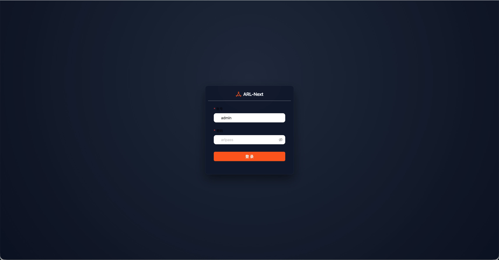
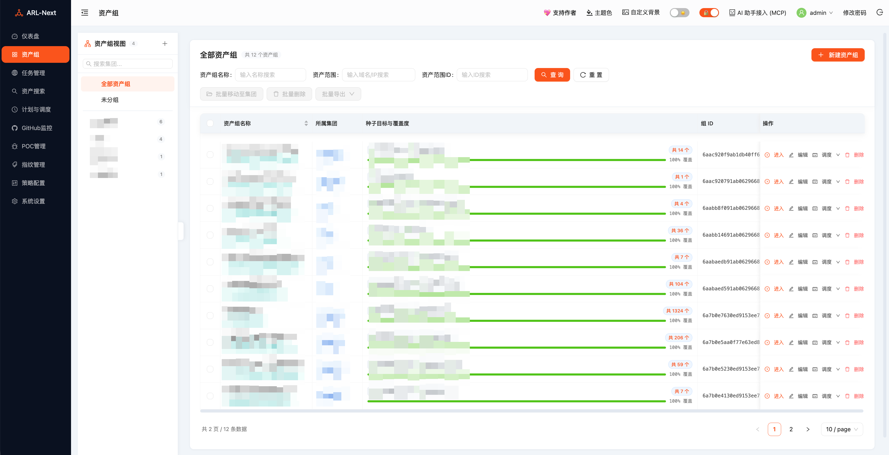
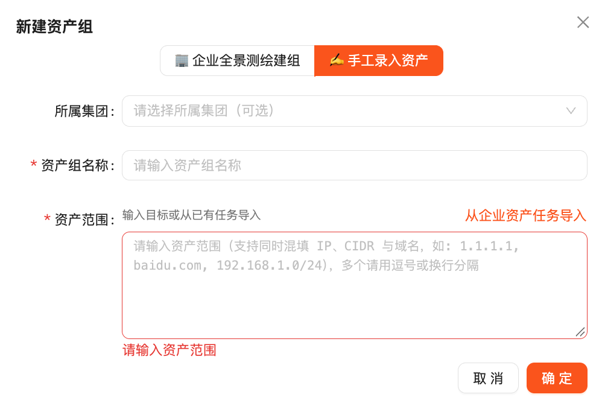
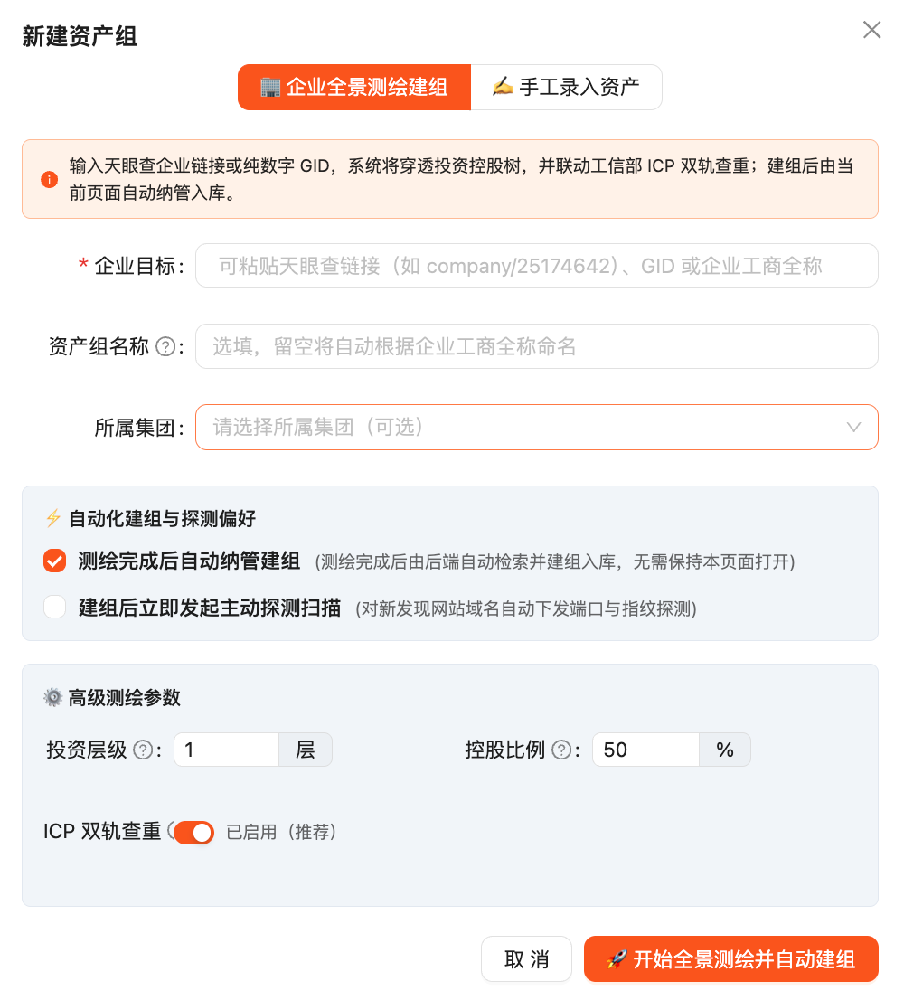
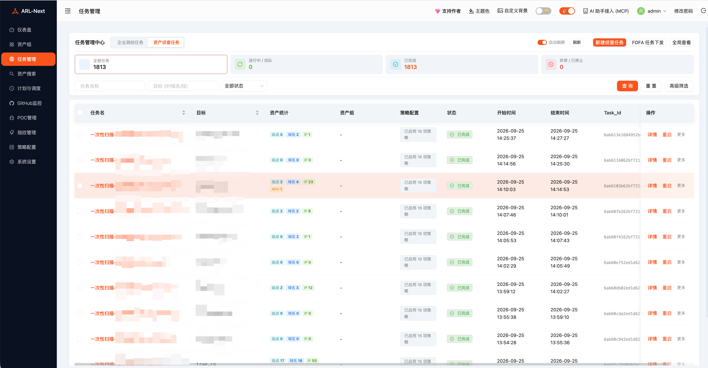
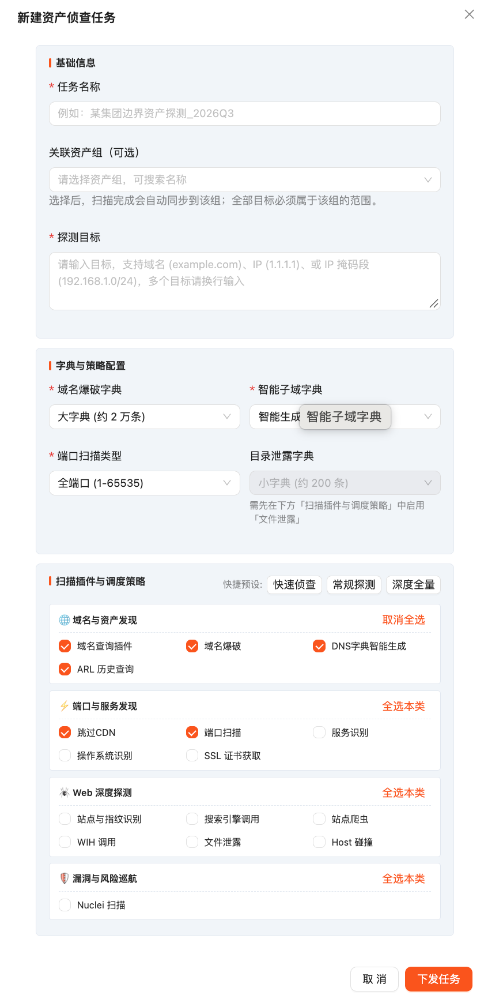
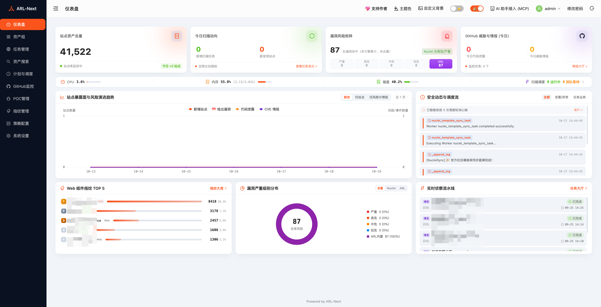

# ARL-Next 快速入门（5 分钟基线）

> 目标：5 分钟走通「登录 → 建组 → 下发首个任务 → 查看结果」最小闭环。
> 本页仅保留最小路径，细节下沉至 `README.md`、`docs/API_GUIDE.md` 与 `CHANGELOG.md`。

<p align="center"></p>

---

## 本次更新预览（v1.4.2）

- **企业全景测绘建组**：「资产组 → 新建资产组」收敛为「企业全景测绘建组 / 手工录入资产」双模式，测绘完成后由后端自动建组纳管，无需保持页面打开。
- **任务可关联资产组**：新建资产侦查任务支持可选「关联资产组」，扫描完成后自动同步至该组。
- **系统设置可搜索**：「系统设置」顶部支持关键词搜索直达（如 `FOFA`、`并发`、`Webhook`），并发页明确区分 Worker 进程数与单任务内发包并发度。
- 完整变更见 [`CHANGELOG.md`](../CHANGELOG.md)。

---

## 前置条件

- 一台可访问的服务器，已放行 **5173** TCP 端口（安全组与本机防火墙均需放行）。
- 服务器具备 root 权限；推荐配置 **4 核 4G 及以上**；脚本会自动补齐 Docker 与 Swap，无需预装。

---

## 步骤 1：部署并登录（约 1 分钟）

在服务器终端执行（国内镜像快速部署）：

```bash
mkdir -p ~/ARL-Next && cd ~/ARL-Next && \
docker pull crpi-laul1izptqrf0tkf.cn-beijing.personal.cr.aliyuncs.com/owl234-arl-prod/arl-web:latest && \
docker rm -f arl-temp 2>/dev/null || true && \
docker create --name arl-temp crpi-laul1izptqrf0tkf.cn-beijing.personal.cr.aliyuncs.com/owl234-arl-prod/arl-web:latest && \
docker cp arl-temp:/code/start-prod.sh ./ && \
docker cp arl-temp:/code/docker-compose.prod.yml ./ && \
docker cp arl-temp:/code/updater ./ && \
docker cp arl-temp:/code/version.txt ./ && \
docker cp arl-temp:/code/CHANGELOG.md ./ && \
mkdir -p ./frontend && docker cp arl-temp:/code/frontend/default.conf.prod ./frontend/ && \
docker rm -f arl-temp && \
chmod +x start-prod.sh && bash start-prod.sh
```

部署完成后访问 `https://<你的服务器IP>:5173`（首次自签名证书按浏览器提示继续前往）。

| 验证层级 | 默认账号 | 默认密码 | 说明 |
| :--- | :--- | :--- | :--- |
| ARL-Next 系统登录 | `admin` | `arlpass` | 首次登录后建议立即修改 |

> 说明：Nginx Basic Auth 前置网关默认关闭，如需开启请在顶部导航栏安全开关处操作。

---

## 步骤 2：建组（约 1 分钟）

> **新手默认走「手工录入资产」**：零凭据、零等待，填完即有组可用。
> 「企业全景测绘建组」是进阶路线——天眼查 GID 穿透需要商业凭据（无凭据会被弹窗引导去配），且测绘是异步后台任务。

进入左侧菜单「资产组」→ 点击「新建资产组」→ 选择「✍️ 手工录入资产」：

<p align="center"></p>

在「资产范围」直接填写目标，支持混填 IP、CIDR 与域名（如 `1.1.1.1, baidu.com, 192.168.1.0/24`），多个以逗号或换行分隔。

<p align="center"></p>

<details>
<summary><b>进阶：企业全景测绘建组（需天眼查凭据 / 异步等待）</b></summary>
<br/>

选择「🏢 企业全景测绘建组」，在「企业目标」粘贴天眼查链接（如 `company/25174642`）、GID 或企业工商全称：

<p align="center"></p>

- 输入 **GID / 天眼查链接**：需要先在「系统设置 → 资产测绘与情报」配置天眼查商业凭据，否则弹窗提示去配置。
- 输入 **企业工商全称**：走工信部官方备案检索，无需商业凭据；后端若匹配到天眼查主体会自动升级为全景双轨测绘。
- 「资产组名称」留空则按企业工商全称自动命名；保持「测绘完成后自动纳管建组」开启即可关闭页面等待后端建组。

</details>

---

## 步骤 3：下发首个任务（约 1 分钟）

> **新手默认选「快速侦查」预设**：耗时最短，先跑通闭环；按需再试常规/深度。

进入「任务管理」→ 先点击「资产侦查任务」切换视图 → 点击「新建侦查任务」（弹窗标题「新建资产侦查任务」）：

<p align="center"></p>

1. 「任务名称」填写可辨识的名称（如 `某集团边界资产探测_2026Q3`）。
2. 「关联资产组（可选）」如已建组可直接选择；选择后扫描完成会自动同步到该组，且全部目标必须属于该组范围。
3. 「探测目标」填写域名（`example.com`）、IP（`1.1.1.1`）或网段（`192.168.1.0/24`），多个目标换行输入。
4. 快捷预设直接点「快速侦查」。
5. 点击「下发任务」。

<p align="center"></p>

<details>
<summary><b>进阶：常规探测 / 深度全量怎么选</b></summary>
<br/>

- 「常规探测」：在快速侦查基础上追加服务识别、SSL 证书获取、文件泄露；覆盖较全面，耗时中等。
- 「深度全量」：启用全部插件，并关闭「跳过 CDN」（将对 CDN 节点 IP 一并扫描）；覆盖面最大、耗时与资源占用最高，套用前会二次确认。

> 提示：域名目标逐个建任务，IP / CIDR 合并为一个任务；弹窗内会如实预告派生数量。

</details>

---

## 步骤 4：查看结果（约 2 分钟）

<p align="center"></p>

- 在「任务管理」按状态筛选跟进：`进行中`、`排队中`、`已完成`、`已停止`、`异常失败`；运行阶段会显示为「进行中 · <阶段名>」（如「进行中 · 端口扫描」）。
- 任务完成后进入任务详情查看域名、站点、服务、漏洞分布；已关联资产组的任务会透出资产组标签，点击可穿透至资产组。
- 在「资产搜索」或资产组详情中使用画像抽屉下钻站点、证书、泄露与漏洞维度。

---

## 步骤 5：下一步

- 需要周期执行：进入「计划与调度」，区分「扫描计划任务」与「资产持续监控」。
- 需要调并发：进入「系统设置 → 扫描与并发 → 任务队列并发」，三项均为 Worker 进程数；单任务内发包并发度在「高级扫描与环境」中调整，二者不是同一量级。
- 需要对接自动化：访问 `https://<你的服务器IP>:5173/api/doc` 并参阅 `docs/API_GUIDE.md`；AI 协同见 `mcp-server/README.md`。

---

## 升级提示

- 建议在任务空闲时段升级：在「系统设置 → 系统版本与更新」页触发更新（界面按钮标签为「一键系统更新」）会重启后台 Worker，正在运行的扫描任务将被中断。
- 数据兼容：升级时自动执行增量迁移并补齐缺失字段，不覆盖已保存配置；持久化卷名保持不变。

---

## 排错速查

- 浏览器报证书不安全：自签名证书属预期行为，按页面提示继续前往，或按 `README.md` 替换商业证书。
- 忘记密码：见 `README.md` 常见问题 Q2（平台密码与 Basic Auth 分开处理）。
- 更新失败提示触发更新失败：见 `README.md` 常见问题 Q3（终端手动升级或重启 `arl-updater.service`）。

---

## 相关链接

- [部署与运维（README）](../README.md) · [API 调用约定](API_GUIDE.md) · [MCP 配置](../mcp-server/README.md) · [更新日志](../CHANGELOG.md)
